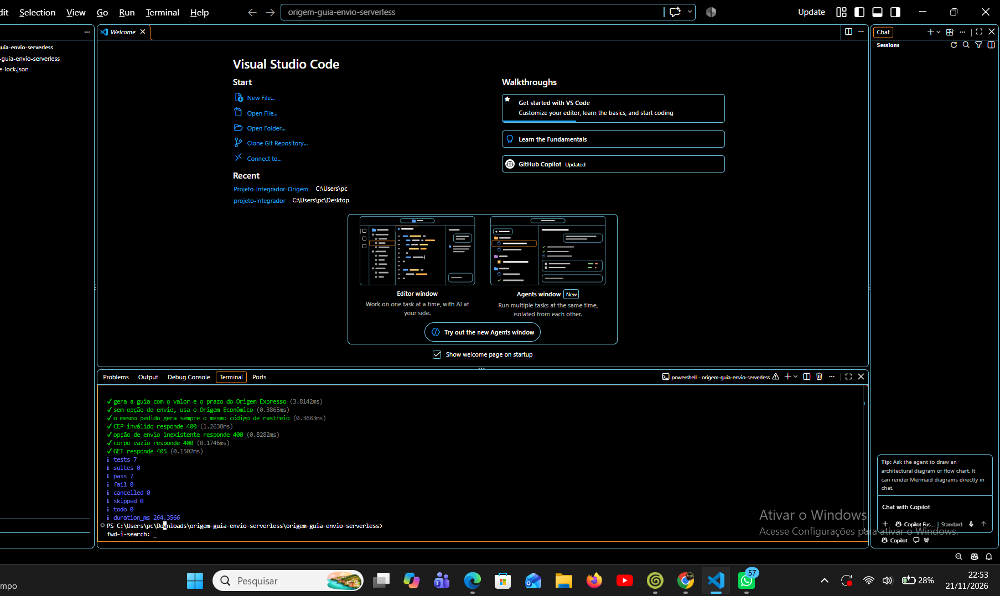
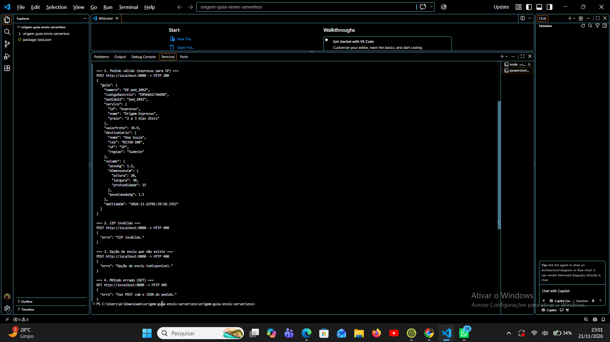

# Origem · Guia de envio serverless

**Atividade individual 1: Serverless** · Infraestrutura de Software · ADS · CESAR School 2026.2
**Aluna:** Lara Thaylanne Ho da Silva

Função HTTP serverless que recebe um pedido do **Origem** (marketplace do artesanato de Pernambuco, nosso Projeto Integrador) e devolve a **guia de envio** do pacote: serviço, valor do frete, prazo, código de rastreio e dados do volume.

> O enunciado usa o Rota Vital como exemplo e permite outro fluxo do sistema do grupo. Escolhi o envio de pedidos do Origem, que é o equivalente à "guia de transporte": quando o artesão vai despachar uma peça, ele precisa da guia.

## Provedor

**Google Cloud Functions (2ª geração)**, rodando localmente com o emulador oficial do Google, o [Functions Framework para Node.js](https://github.com/GoogleCloudPlatform/functions-framework-nodejs). Publicar na nuvem é opcional e não foi feito.

## Como rodar

Requisito: Node.js 20 ou mais novo.

```bash
npm install        # baixa o emulador (Functions Framework)
npm test           # roda os 7 testes
npm start          # sobe a função em http://localhost:8080
```

Com a função rodando, abra **outro terminal** na mesma pasta e rode:

```bash
npm run chamar     # faz as 4 chamadas de evidência
```

Ou chame na mão (no Windows use `curl.exe`):

```bash
curl.exe -X POST http://localhost:8080 -H "Content-Type: application/json" --data "@exemplos/pedido-valido.json"
```

## Contrato

`POST /` com JSON:

| Campo | Tipo | Obrigatório | Regra |
|---|---|---|---|
| `pedidoId` | texto | sim | não pode ser vazio |
| `opcaoEnvioId` | texto | não | `economico` (padrão) ou `expresso` |
| `destinatario.nome` | texto | sim | |
| `destinatario.cep` | texto | sim | `00000000` ou `00000-000` |
| `destinatario.uf` | texto | sim | uma das 27 UFs |
| `pesoKg` | número | sim | maior que 0, até 1000 |
| `dimensoes.altura/largura/profundidade` | número (cm) | sim | maiores que 0 |

Respostas:

| Situação | Status | Corpo |
|---|---|---|
| Pedido válido | 200 | `{ "guia": { ... } }` |
| Dado inválido ou opção inexistente | 400 | `{ "erro": "..." }` |
| Método diferente de POST | 405 | `{ "erro": "Use POST com o JSON do pedido." }` |

Os valores e prazos são os mesmos do backend do Origem (`backend/app/src/lib/frete.ts`):

| Serviço | Valor | Prazo |
|---|---|---|
| Origem Econômico | R$ 18,00 | 6 a 8 dias úteis |
| Origem Expresso | R$ 34,90 | 2 a 3 dias úteis |

## Casos de teste (resultado esperado)

| # | Requisição | Status | Resposta |
|---|---|---|---|
| 1 | `exemplos/pedido-valido.json` | 200 | guia `GE-ped_1042`, rastreio `OR566617366BR`, Origem Expresso, R$ 34,90, CEP `01310-100`, região Sudeste, peso cubado 1,5 kg |
| 2 | `exemplos/pedido-cep-invalido.json` | 400 | `CEP inválido.` |
| 3 | `exemplos/pedido-opcao-indisponivel.json` | 400 | `Opção de envio indisponível.` |
| 4 | `GET /` | 405 | `Use POST com o JSON do pedido.` |

O campo `emitidaEm` muda a cada chamada (data e hora da emissão); o resto é sempre igual.

## Estrutura

```
index.js            registra a função no Functions Framework (ponto de entrada)
src/handler.js      camada HTTP: método, status e JSON
src/guia.js         regra de negócio: validação, frete, rastreio, peso cubado
test/guia.test.js   7 testes (node:test, sem dependência extra)
exemplos/           corpos JSON usados nas evidências
scripts/chamar.js   faz as 4 chamadas contra a função rodando
evidencias/         prints da execução
```

## Decisões

- **Google Cloud Functions + Functions Framework:** o emulador é um pacote npm comum. Não precisa de Docker, conta na nuvem nem cartão para rodar local, e o mesmo código sobe na nuvem com `gcloud functions deploy` se um dia for publicado.
- **Regra separada da camada HTTP:** `guia.js` não sabe nada de HTTP, então dá para testar sem subir servidor e trocar de provedor (AWS Lambda, Azure, Cloudflare) mexendo só no `index.js`/`handler.js`.
- **Sem estado e sem banco:** a função recebe tudo de que precisa na requisição e não guarda nada. É isso que permite ao provedor criar e destruir instâncias à vontade (escala a zero).
- **Código de rastreio determinístico:** gerado a partir do `pedidoId` com SHA-256. Se o provedor repetir a chamada (retry) ou o artesão pedir a guia de novo, o código é o mesmo (idempotência).
- **Peso cubado:** `altura × largura × profundidade / 6000`, a fórmula usada pelas transportadoras para peças leves e volumosas, comum no artesanato (luminárias, cestos).

## Evidências

1. Testes passando (`npm test`): 
2. Emulador rodando (`npm start`): 
3. Chamadas à função (`npm run chamar`): 

Vídeo (até 3 min): **COLAR O LINK DO VÍDEO AQUI**

## Uso de IA

Usei o Claude (Anthropic) para escrever o código, os testes e este README, a partir das regras de frete que já existiam no repositório do Origem. Rodei, conferi as respostas e gravei as evidências no meu computador.
